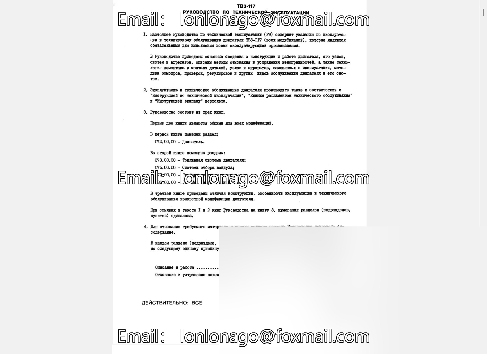
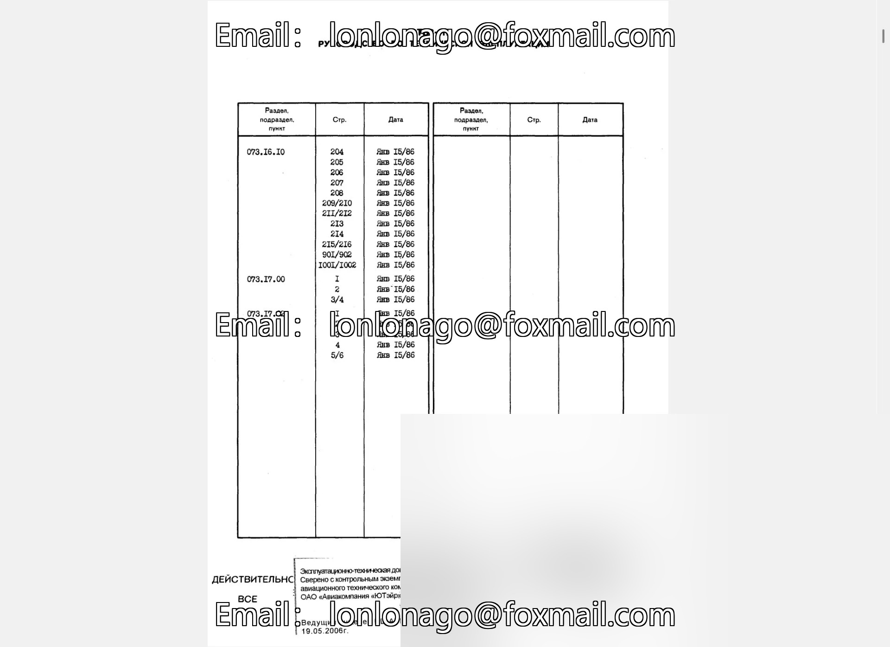
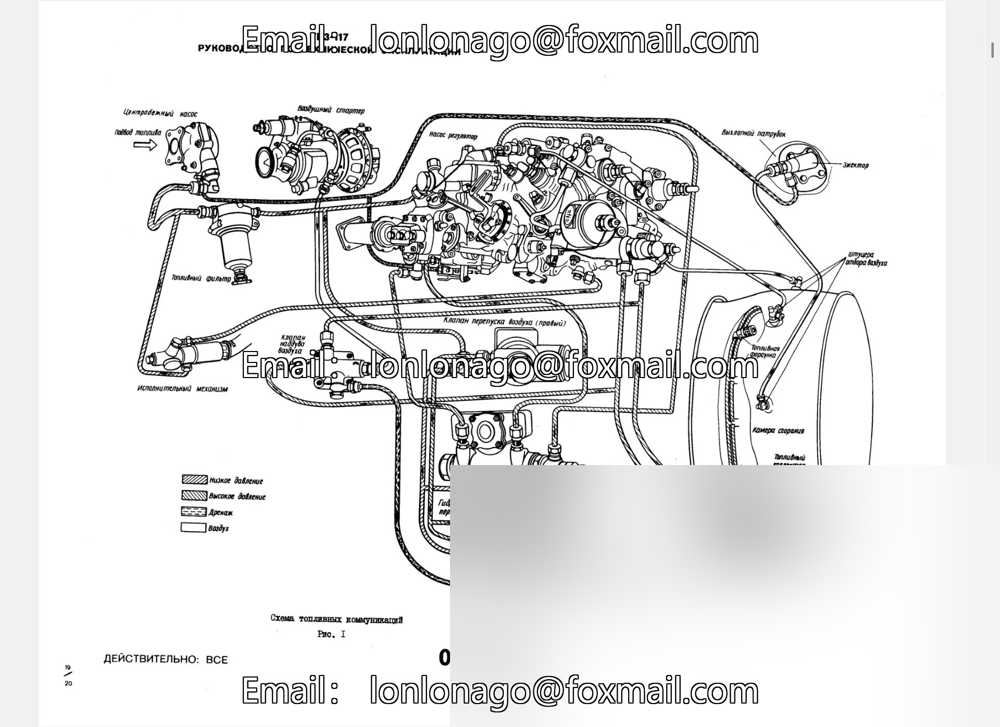
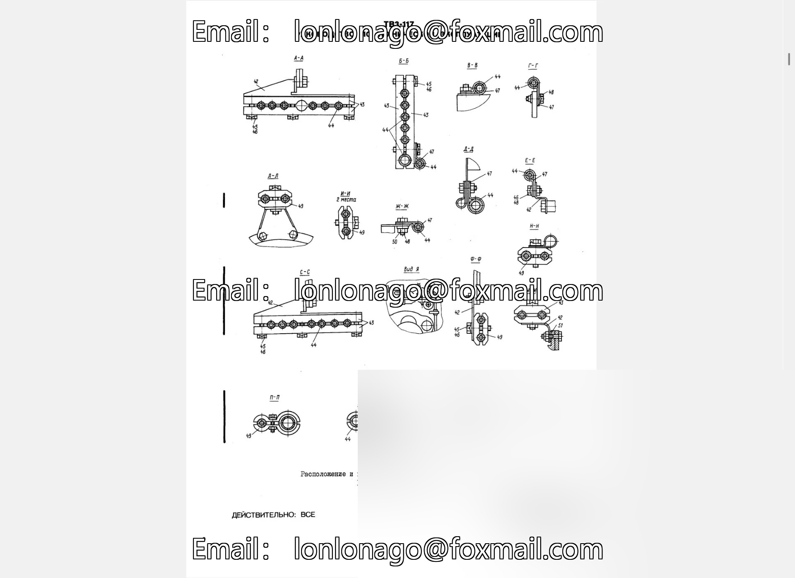
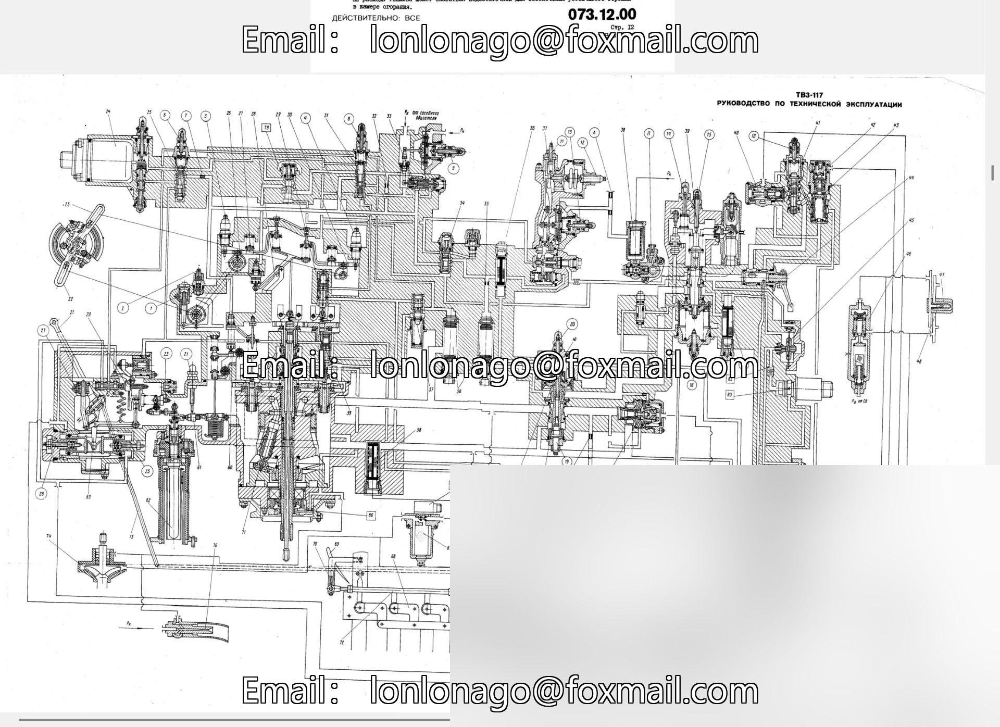
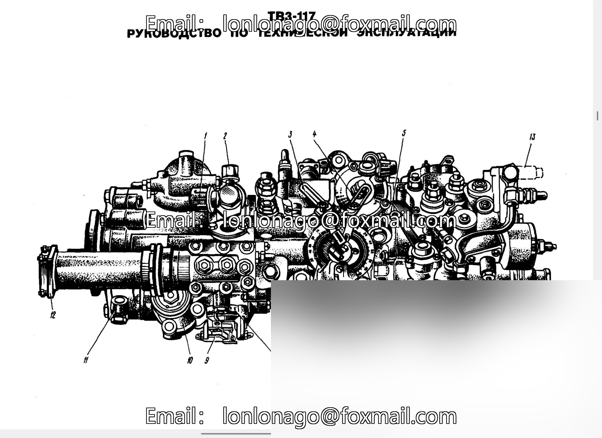

# TV3-117 engine design materials

## Body

TV3-117 engine design materials TV3-117 type turbine shaft engine technical maintenance manual, 500 pages.
Russian original , covering engine technical parameters, maintenance procedures, part numbers, system diagrams, etc., suitable for reference for aviation engine technical research and maintenance study.

may be copied, and are not refundable upon sale.

The material is the TV3-117 type turbomachinery shaft engine maintenance manual, covering technical parameters, maintenance procedures, part numbers and system diagrams, in 500 pages with an Russian original version; it is suitable for aviation engine technical research and maintenance learning.

<!-- AI_ENRICHED -->

## Images

## Payment

Here is a pay link on Stripe ( https://buy.stripe.com/3cs8yP7sY87d0vu9AB ). Please contact me lonlonago@foxmail.com after funding $89, and I will send you a complete data files , thank you!

